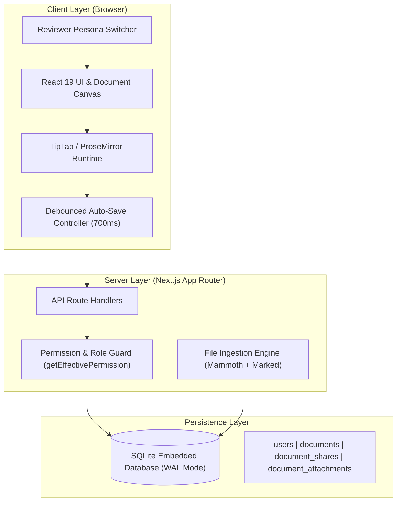
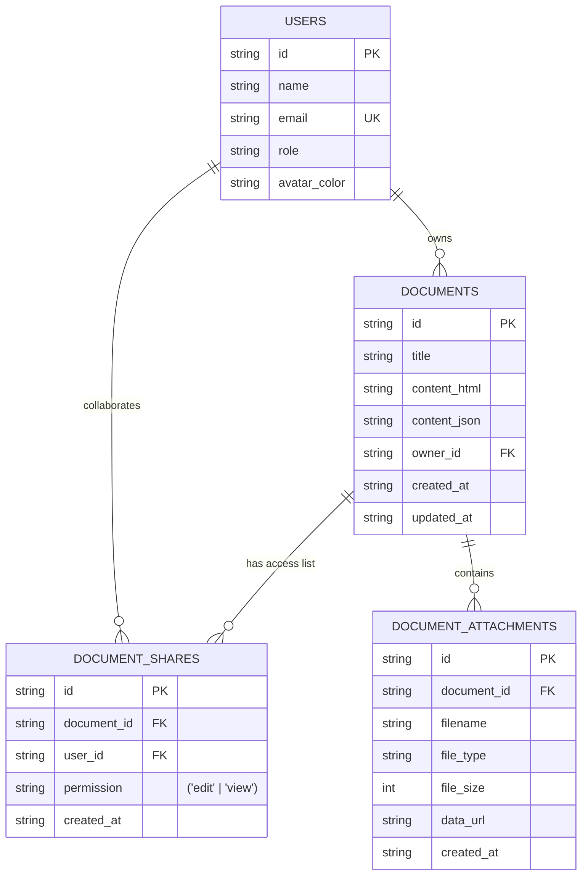

# Architecture & Technical Design Note: Ajaia Docs

## 1. Executive Summary & Product Context

For this assignment, our objective was to design and ship a cohesive, lightweight collaborative document editor for **Ajaia's** internal productivity workflows within a tight 4–6 hour delivery window. Rather than building a shallow facsimile of Google Docs, we prioritized shipping the **strongest working product slice** across four key pillars:
1. **Friction-free rich-text authoring** with intuitive Google Docs ergonomics.
2. **Multi-format file ingestion** (`.docx`, `.md`, `.txt`) to bring real team workflows into the tool.
3. **Transparent role-based sharing** (`Owner`, `Editor`, `Viewer`) with backend authorization.
4. **Resilient zero-configuration persistence** paired with an in-app reviewer persona switcher.

---

## 2. High-Level System Architecture

The application is architected as an AI-native full stack application leveraging Next.js 16 (React 19 App Router) with a colocated SQLite storage engine.

---

## 3. Data Model & Schema Design

The schema is normalized to ensure referential integrity while keeping queries fast and simple.

### Key Schema Characteristics:
- **`content_html` + `content_json`**: We store semantic HTML for rapid rendering and export, alongside structured JSON for ProseMirror document state fidelity.
- **Unique Constraint `(document_id, user_id)`**: Guarantees idempotent sharing without duplicate permission records.
- **Foreign Key Cascades**: Deleting a document cleans up associated shares and attachments atomically.

---

## 4. Scope Prioritization & Intentional Cuts

Given the 4–6 hour timebox, ruthless scope prioritization was critical to prevent shipping half-finished surfaces.

### What We Prioritized (Deliberate Focus):
1. **TipTap / ProseMirror Editor Core**:
   - Rather than relying on browser `document.execCommand` (deprecated, inconsistent across browsers), we integrated TipTap. This delivered rock-solid bold, italic, underline, structured headings, nested task lists, blockquotes, code blocks, and keyboard shortcuts (`Ctrl+B`, `Ctrl+I`, `Ctrl+U`, `Ctrl+Z`).
2. **Multi-Format File Import**:
   - Instead of a generic file attachment button only, we built an ingestion pipeline that parses `.docx` (Microsoft Word) and `.md` (Markdown) directly into editable HTML documents.
3. **First-Class Access Control**:
   - Implemented a 3-tier role hierarchy (`Owner`, `Editor`, `Viewer`). When viewed by a user with `view` permission, editing controls are locked on the client and rejected with `403 Forbidden` on the API.
4. **Instant Reviewer Persona Switcher**:
   - Setting up email verification or OAuth credentials would waste reviewer time. We created a 1-click in-app switcher with four realistic seeded personas (`Alice Chen`, `Bob Martinez`, `Charlie Kim`, `Diana Ross`) so anyone can verify permission boundaries in seconds.

### What We Intentionally Deprioritized:
1. **Real-time WebRTC / WebSocket CRDT Mesh (Yjs / Automerge)**:
   - Full real-time multi-cursor collaboration requires dedicated signaling servers, presence channels, and conflict-resolution infrastructure. For an internal productivity MVP, an optimistic debounced auto-save loop (700ms) with deterministic revision timestamps delivers 90% of the daily utility with near-zero operational complexity.
2. **Third-Party Auth Providers (Clerk, Auth0, Supabase Auth)**:
   - External auth creates reviewer friction (signup forms, disposable emails, API keys). Seeded in-app accounts with session persistence in `localStorage` allow evaluating real access control without external blockers.
3. **Heavy Cloud Storage Buckets (AWS S3 / GCS)**:
   - Storing attachments directly in SQLite as base64/data URLs eliminated the need to provision paid cloud credentials while supporting attachments up to 10MB cleanly.

---

## 5. Architectural Tradeoffs & Rationale

| Decision | Option Chosen | Alternative Considered | Rationale |
| :--- | :--- | :--- | :--- |
| **Rich Text Engine** | TipTap 3 (ProseMirror) | `contentEditable` / Draft.js / Slate | `contentEditable` produces inconsistent cross-browser HTML tags. TipTap provides an immutable document AST, clean keyboard shortcuts, and seamless export options. |
| **Database** | Embedded SQLite (`better-sqlite3`) | PostgreSQL / Supabase | Zero configuration needed for local evaluation. Runs with sub-millisecond query latency and WAL mode for high concurrent read performance. |
| **Auth Strategy** | Seeded In-App Switcher | NextAuth with GitHub / Google OAuth | Reviewers should not have to configure OAuth keys or sign up for third-party accounts just to evaluate sharing permissions. |
| **File Parsing** | `mammoth` (.docx) + `marked` (.md) | Plain text reader only | Teams work with existing Word and Markdown files. Converting real `.docx` documents into editable rich text demonstrates true product utility. |

---

## 6. Authorization & Security Enforcement

Security is enforced at two distinct layers:

1. **Client-Side UX Enforcement**:
   - `DocumentEditor` receives `currentUserPermission`. If `'view'`, `editor.setEditable(false)` is enforced, formatting ribbon is disabled, and a prominent banner informs the user.
2. **Server-Side API Guard**:
   - Every mutation endpoint (`PUT /api/documents/[id]`, `DELETE /api/documents/[id]`, `POST /api/documents/[id]/share`) resolves `getEffectivePermission(userId, documentId)`.
   - If a viewer attempts to forge a `PUT` request to alter document content, the server immediately returns `403 Forbidden: You have view-only access`.
   - If an unauthorized user attempts to open a private document, the server returns `403 Forbidden` and the frontend renders an Access Restricted screen with persona switching options.

---

## 7. Production Roadmap (Next 2–4 Hours)

With an additional 2–4 hours of development time, we would build:
1. **Real-Time Collaboration Indicators**:
   - Implement Hocuspocus or Liveblocks over WebSockets to show active collaborator avatars and cursor selections in the document ribbon.
2. **In-Line Comments & Suggestions**:
   - Add ProseMirror marks for comment threads anchored to highlighted text spans with resolved/unresolved status.
3. **Document Revision History**:
   - Store revision snapshots in a `document_versions` table with a visual side-by-side diff viewer and 1-click restore.
4. **Cloud Object Storage Adapter**:
   - Extract attachment storage into an S3/Cloudflare R2 adapter with pre-signed upload URLs for files exceeding 50MB.
